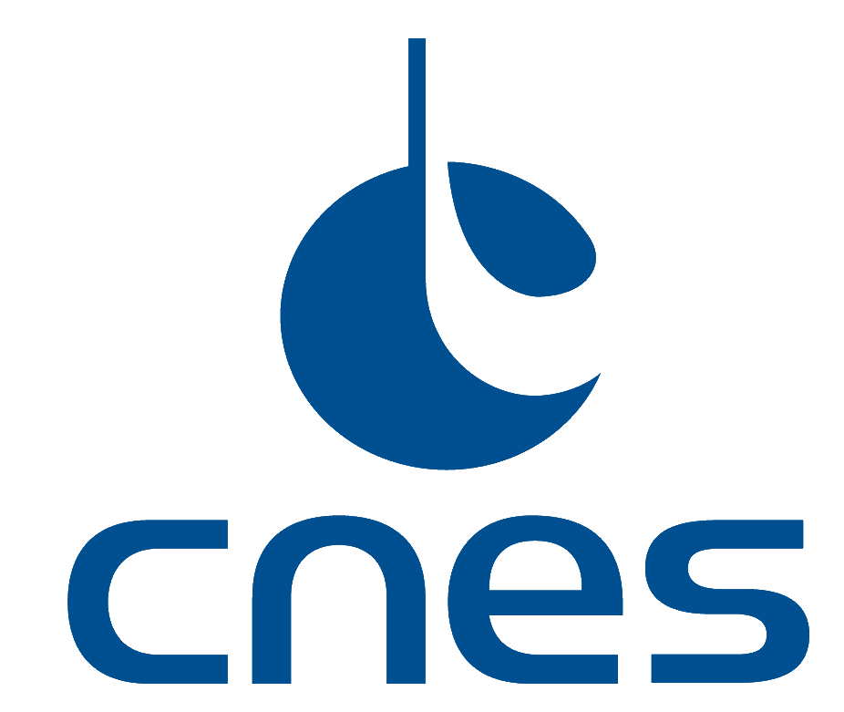

# XSMP Modeler

XSMP Modeler is a framework for developing SMDL (Simulation Model Definition Language) models as defined in the ECSS SMP standards.

## Documentation

User documentation is published at:

- <https://thalesgroup.github.io/xsmp-modeler/>

The published documentation covers:

- installation from the Visual Studio Marketplace
- project creation with the wizard
- command-line usage
- projects, tools and profiles
- the full XSMP language set
- the built-in user-facing tools and profiles

## Installation

Install **XSMP Modeler** from the Visual Studio Marketplace:

- <https://marketplace.visualstudio.com/items?itemName=ydaveluy.xsmp-modeler>

Requires VS Code **1.101 or newer**.

## Development

Use Node.js 22.13 or newer, then run `npm ci`, `npm run build`, and `npm test`.
The `tsc` command uses TypeScript 7. The `typescript` dependency aliases the
TypeScript 6 compatibility package because ESLint still needs its JavaScript API,
following the [official side-by-side setup](https://devblogs.microsoft.com/typescript/announcing-typescript-7-0/#running-side-by-side-with-typescript-60).

Langium 4.4 requires the LSP 10.1 stack. Keep the client and server on 10.1.2 and
the protocol on 3.18.4 so they share one JSON-RPC runtime, including when installing
`@xsmp/core` independently. Mixing the LSP 10 and 11 runtimes breaks typed requests
and cancellation errors. The protocol peer dependency makes npm reject an
incompatible application dependency. VS Code types stay on 1.101 to match the
oldest supported editor.

## Sponsors

## License

This project is licensed under the [MIT License](LICENSE).
